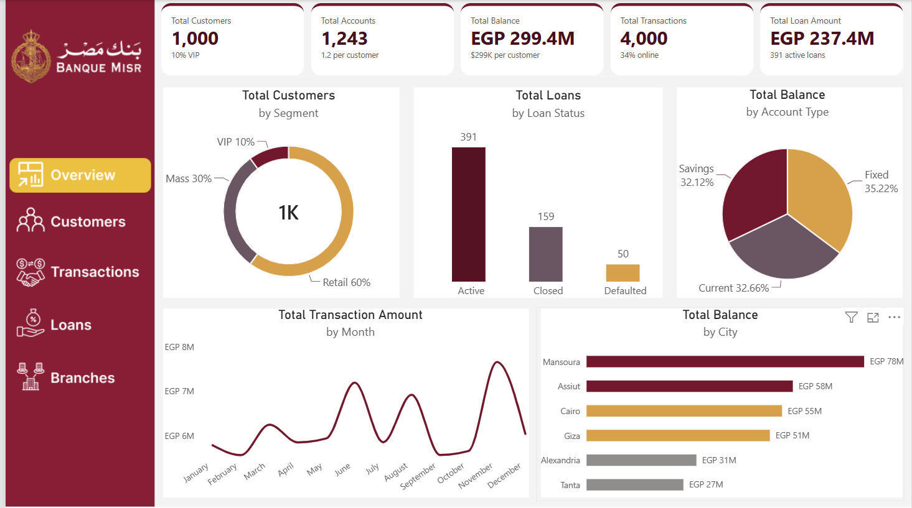
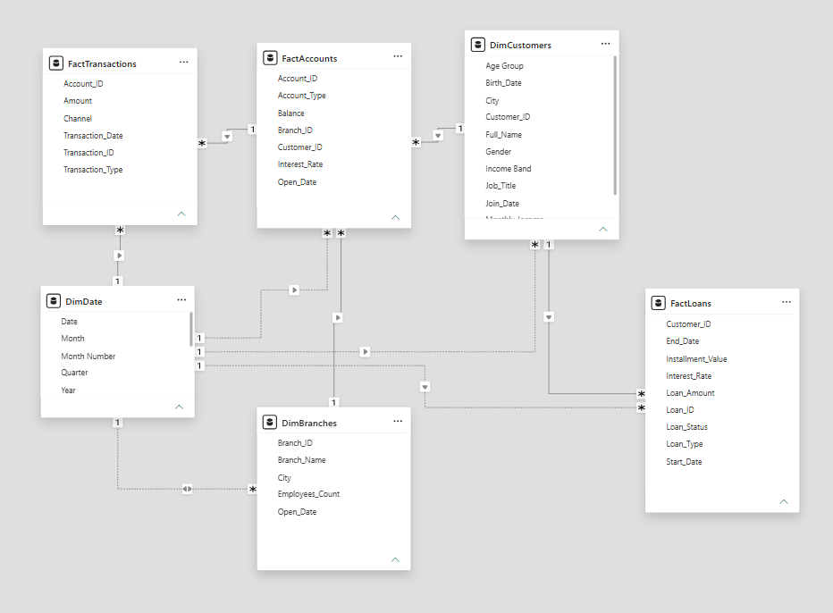

# Banque Misr Performance Dashboard (Power BI)

An interactive Power BI dashboard and written analytical report on a Banque Misr sample dataset, covering **customers, accounts, transactions, loans and branches**. The goal is to give an executive audience a clear view of customer behavior, credit risk, channel usage and branch productivity.

> **Disclaimer:** This is an independent portfolio / academic project. It is not affiliated with or endorsed by Banque Misr, and the figures come from a sample dataset, not from the bank's real records.



## What's in this project

| Page | What it answers |
|---|---|
| Landing | Entry point to the analysis |
| Overview | Size of the bank at a glance: customers, accounts, balances, transactions, loans, default rate |
| Customers | Who the customers are: gender, city, income, job titles, balance by segment |
| Transactions | How money moves: channels, busiest branches, monthly amounts by type, net cash flow |
| Loans | Portfolio health: status, default rate by segment, amount and count by loan type |
| Branches | Network efficiency: balances, accounts by city, staffing vs productivity |

## Data model

A Galaxy schema built from five source files (Customers, Accounts, Transactions, Loans, Branches) plus a date table.

- **Facts:** `FactTransactions`, `FactAccounts`, `FactLoans`
- **Dimensions:** `DimCustomers`, `DimBranches`, `DimDate`
- Relationships are one-to-many with single-direction filtering. Date relationships other than transactions are inactive and activated with `USERELATIONSHIP` where needed.



## DAX highlights

- Core measures: `Total Customers`, `Total Balance`, `Total Loan Amount`, `Default Rate`, `Net Cash Flow`, `Transactions per Employee`
- Comparison measures that ignore slicers using `CALCULATE(..., ALL(...))`, to show "vs all" arrows
- `RANKX`, `TOPN`, `CONCATENATEX` for ranked lists and heat tables

All chart measures are in [`dax/Banque_Misr_HTML_charts.dax.txt`](dax/Banque_Misr_HTML_charts.dax.txt).

## Custom HTML/CSS visuals

Every KPI card and chart is an **HTML Content** visual driven by a DAX measure that returns HTML and CSS. This gives full control over the layout and lets the visuals apply **conditional formatting in code**:

- Default Rate becomes Low / Watch / High based on thresholds
- ▲ / ▼ pills compare the current selection with the overall average
- Net Cash Flow turns gold for a surplus and wine for a deficit
- Rank-based colors on ranked lists, maps and heat tables

Palette: wine `#71182D`, gold `#D7A04A`, taupe `#A39A84`, text `#470E1C`, card `#E8E0CC`.

## Key findings

1. **Wealth is concentrated.** The 100 VIP customers (10%) hold about 70% of the 299.4M EGP balance, while Retail (60% of customers) holds about 9%.
2. **Credit risk sits in Retail and mortgages.** The overall default rate is 8.3%, rising to 11.0% in Retail and 11.6% for mortgages.
3. **Cairo has volume but not depth.** It has the most accounts (316) but about 174K EGP per account, against roughly 290K to 300K in Mansoura and Assiut.
4. **Branches still carry about a third of transactions** (ATM 34.2%, Online 34.0%, Branch 31.9%), so there is room to move routine activity to digital channels.
5. **A positive year hides volatile cash flow.** Net cash flow is +335K EGP, but six months are in deficit. May alone is -861K.
6. **Staffing does not track productivity.** Branches 16 and 8 are the most heavily staffed but sit well below the 7.9 transactions-per-employee average.

The full write-up with recommendations is in [`report/BanqueMisr_Analytical_Report.pdf`](report/BanqueMisr_Analytical_Report.pdf).

## Repository structure

```
banque-misr-powerbi-dashboard/
├── README.md
├── dashboard/
│   └── BanqueMisr.pbix
├── report/
│   └── BanqueMisr_Analytical_Report.pdf
├── dax/
│   └── Banque_Misr_HTML_charts.dax.txt
├── images/
│   ├── landing.png
│   ├── overview.png
│   ├── customers.png
│   ├── transactions.png
│   ├── loans.png
│   ├── branches.png
│   └── data-model.png

```

## How to open it

1. Install **Power BI Desktop**.
2. Open `dashboard/BanqueMisr.pbix`.
3. The HTML visuals use the **HTML Content** custom visual from AppSource. If it shows as missing, add it from the Visualizations pane (Get more visuals).

## Tools

Power BI Desktop, DAX, Power Query, HTML and CSS (via the HTML Content visual).
